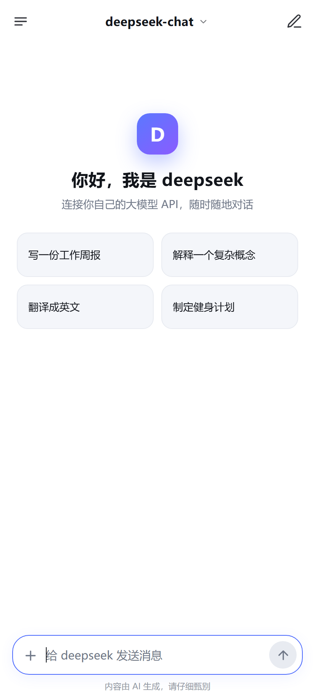

# Android API

一个轻量 Android AI 对话客户端，直接连接用户配置的大模型 API。应用桌面名称为 deepseek，源码项目名为 Android API。

## 功能

- 同时配置并切换多个服务商和模型
- 支持 OpenAI 兼容接口与 Anthropic 原生协议
- SSE 流式回复、停止生成、重新生成和复制
- DeepSeek 思考过程折叠显示，Markdown 格式可视化
- 会话本地保存，支持重命名、删除和时间分组
- 深色、浅色和跟随系统主题，字号与生成参数可配置
- 图片和视频附件；是否能识别由所选模型与服务商决定
- API Key 使用 Android Keystore 加密存储

DeepSeek 官方接口当前仅支持文本。图片和视频需使用服务商及模型支持的视觉输入能力。

## 运行环境

- Android SDK Platform 35
- Android Build Tools 35.0.0
- JDK 17
- Windows PowerShell

最低 Android 版本为 Android 8.0（API 26），目标版本为 API 34。应用使用 Java 与 Android WebView 实现，不依赖第三方 Android 库。

## 构建 APK

先配置 Android SDK。可以设置 ANDROID_SDK_ROOT，或在命令中传入 SDK 路径：

~~~powershell
$env:ANDROID_SDK_ROOT = 'D:\Android\Sdk'
~~~

此项目不包含签名密钥。请在仓库目录之外创建并保管自己的密钥；同一应用的后续升级需要继续使用同一签名证书：

~~~powershell
$env:ANDROID_KEYSTORE_PATH = 'C:\keys\android-api.jks'
$env:ANDROID_KEY_ALIAS = 'androidapi'
keytool -genkeypair -keystore $env:ANDROID_KEYSTORE_PATH -alias $env:ANDROID_KEY_ALIAS -keyalg RSA -keysize 2048 -validity 10950
~~~

keytool 会在终端中提示输入密码。构建时在当前 PowerShell 会话中设置密码，然后运行：

~~~powershell
$secret = Read-Host 'Keystore password' -AsSecureString
$env:ANDROID_KEYSTORE_PASSWORD = [System.Net.NetworkCredential]::new('', $secret).Password
.\build.ps1
~~~

可用 -Sdk 参数指定 SDK 路径，也可用 -DebugBuild 构建调试标记版本。APK 输出到 dist/，该目录默认被 Git 忽略。

## 服务商设置

在应用的“设置 → 模型服务”中添加服务商、API Key 和模型。Base URL 可填写服务商根路径或 /v1；应用会补全接口路径。

| 服务商 | Base URL |
| --- | --- |
| DeepSeek | https://api.deepseek.com |
| OpenAI | https://api.openai.com/v1 |
| Kimi | https://api.moonshot.cn/v1 |
| 智谱 GLM | https://open.bigmodel.cn/api/paas/v4 |
| 通义千问 | https://dashscope.aliyuncs.com/compatible-mode/v1 |
| 硅基流动 | https://api.siliconflow.cn/v1 |
| Anthropic | https://api.anthropic.com（选择 Anthropic 协议） |
| Ollama | http://电脑局域网地址:11434/v1 |

## 隐私说明

请求从手机直接发往用户配置的服务商，不经过本项目的中转服务器。会话保存在应用本地；API Key 使用 Android Keystore 加密。连接公网服务时请使用 HTTPS。
